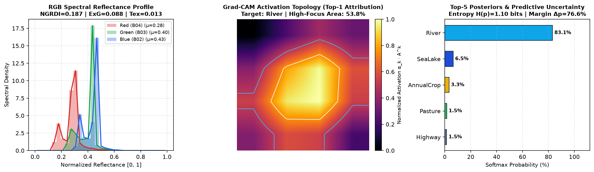
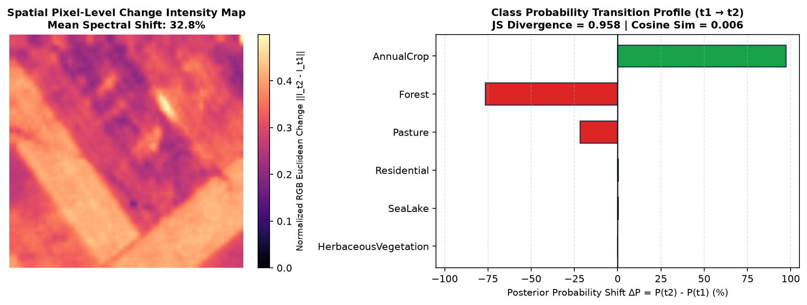
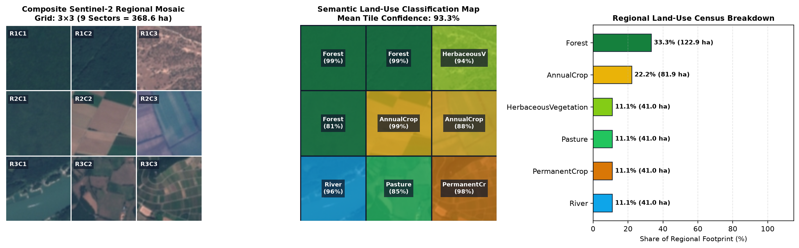
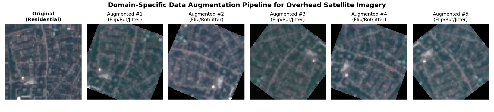
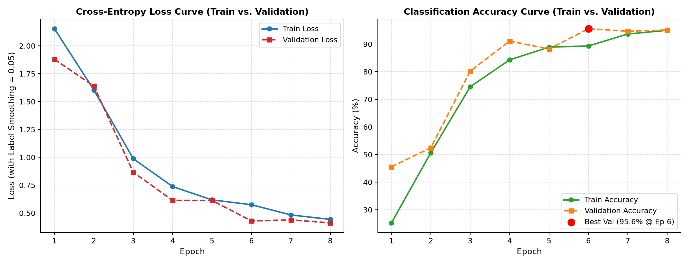
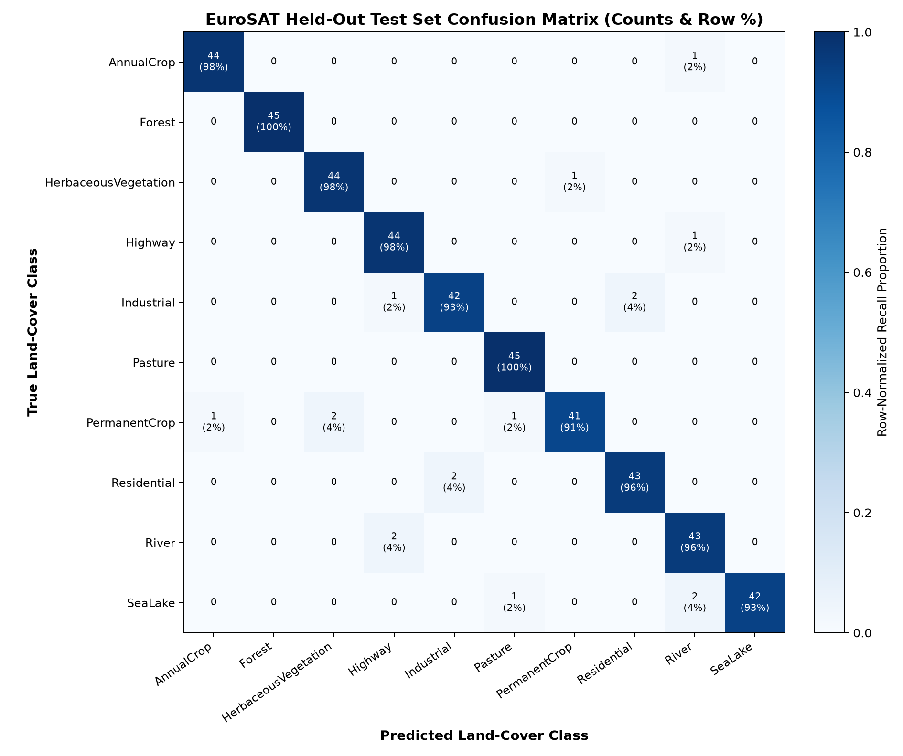
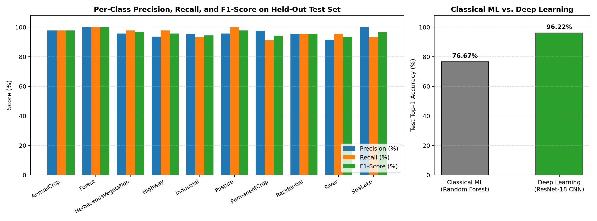
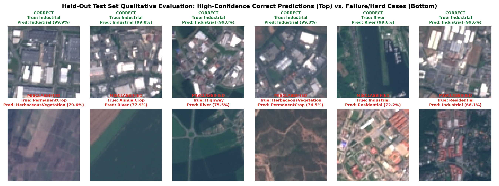

# EuroSAT-Sentinel: Explainable Deep Learning for Satellite Land-Use & Environmental Monitoring

[](https://www.python.org/)
[](https://pytorch.org/)
[](app/gradio_app.py)
[](docs/TESTING_AND_RESULTS.md)
[](docs/TESTING_AND_RESULTS.md)
[](tests/test_pipeline.py)

> **Explainable Deep Learning, Computer Vision & Geospatial Intelligence Platform**  
> An end-to-end, reproducible Deep Learning and Computer Vision system for automated Land-Use and Land-Cover (LULC) classification on Copernicus Sentinel-2 satellite imagery. Features a two-stage fine-tuned **ResNet-18** CNN (`96.22%` Top-1 / `100.00%` Top-3 Test Accuracy), a comparative **60-Feature Classical ML Random Forest Baseline** (`76.67%`), **Counterfactual Grad-CAM Spatial Attribution**, **$4\times$ Dihedral Test-Time Augmentation (TTA)**, **Shannon Entropy Uncertainty Quantification**, **Bi-Temporal Deforestation & Urban Sprawl Change Detection ($t_1 \rightarrow t_2$)**, and a **Multi-Tile Regional Mosaic Semantic Cartography Scanner**.

---

## Table of Contents
1. [Project Motivation & Problem Statement](#1-project-motivation--problem-statement)
2. [Why Deep Learning Is Essential (Spatial CNN vs. Classical ML)](#2-why-deep-learning-is-essential-spatial-cnn-vs-classical-ml)
3. [Key Features & Interactive 5-Tab Platform Capabilities](#3-key-features--interactive-5-tab-platform-capabilities)
4. [Verified Empirical Results](#4-verified-empirical-results)
5. [Visualizations & Diagnostic Outputs](#5-visualizations--diagnostic-outputs)
6. [Repository Architecture](#6-repository-architecture)
7. [Installation & Environment Setup](#7-installation--environment-setup)
8. [Usage: Interactive Gradio App, VS Code, Training & CLI](#8-usage-interactive-gradio-app-vs-code-training--cli)
9. [Complete Documentation Package](#9-complete-documentation-package)
10. [References](#10-references)

---

## 1. Project Motivation & Problem Statement

Monitoring global environmental change—including deforestation, urban sprawl, agricultural intensification, and freshwater reservoir shifts—relies on analyzing continuous streams of overhead imagery from Earth Observation satellites such as the European Space Agency's **Copernicus Sentinel-2** constellation. Manually labeling millions of satellite tiles is unscalable, while deploying black-box classifiers without visual explainability or uncertainty calibration is unsuitable for policy and environmental decision-making.

**EuroSAT-Sentinel** formulates automated satellite land-use monitoring as an explainable supervised Computer Vision and Geospatial Analytics system:
* **Input:** A $64 \times 64$ ($10\text{ m/pixel}$ ground sampling distance, covering $640\text{ m} \times 640\text{ m} = 40.96\text{ hectares}$) Sentinel-2 RGB optical satellite patch (or multi-tile regional mosaic).
* **Outputs:**
  1. **10-Class Land-Use Prediction & Top-$k$ Softmax Posteriors:** (`AnnualCrop`, `Forest`, `HerbaceousVegetation`, `Highway`, `Industrial`, `Pasture`, `PermanentCrop`, `Residential`, `River`, `SeaLake`).
  2. **Grad-CAM & Counterfactual Spatial Attention Heatmaps:** Visual verification of the exact physical landforms (e.g., river bends, highway corridors, building rooftops) driving top-1 or counterfactual class hypotheses.
  3. **Spectral & Predictive Uncertainty Diagnostics:** Live optical vegetation/water indices (`NGRDI`, `ExG`), $4\times$ Dihedral Rotational Test-Time Augmentation consensus, and Shannon predictive entropy ($H(\mathbf{p})$ in bits).
  4. **Bi-Temporal Change ($t_1 \rightarrow t_2$) & Regional Semantic Cartography:** Automated detection of deforestation carbon loss ($\Delta \text{t C}$), urban soil sealing ($\Delta \text{ha}$), and multi-tile regional land-use census tables.

---

## 2. Why Deep Learning Is Essential (Spatial CNN vs. Classical ML)

In nadir overhead satellite imagery, distinct land-use classes share overlapping pixel-level RGB color distributions:
* `River` and `SeaLake` share dark water reflectance but differ in **2D spatial morphology** (meandering channel with riparian banks vs. open water expanse).
* `Highway`, `Industrial`, and `Residential` share grey concrete/asphalt spectra but differ in **structural topology** (continuous linear road corridors vs. large commercial footprints vs. dense residential roof grids).
* `AnnualCrop`, `PermanentCrop`, `Pasture`, and `HerbaceousVegetation` share vegetative chlorophyll spectra but differ in **high-frequency spatial texture**.

To prove this scientifically, we benchmark a **60-feature Classical Machine Learning Random Forest** (48D RGB color histograms + 12D directional spatial gradient moments) against a two-stage fine-tuned **ResNet-18 Convolutional Neural Network** on identical stratified splits. **Deep Learning improves held-out Test Top-1 Accuracy by +19.55% (`96.22%` vs. `76.67%`), cutting the classification error rate by 83.8%.**

---

## 3. Key Features & Interactive 5-Tab Platform Capabilities

* **Tab 1 — 🛰️ Single-Patch XAI & Counterfactual Inspector (`app/gradio_app.py`, `src/inference/predictor.py`):**
  * Interactive Grad-CAM overlay with adjustable opacity ($\alpha \in [0.15, 0.85]$) and 5 colormaps (`jet`, `inferno`, `viridis`, `plasma`, `magma`).
  * **Counterfactual Target-Class Attribution:** Query any of the 10 classes to inspect where the CNN detects alternative landform evidence.
  * **$4\times$ Dihedral Rotation Test-Time Augmentation (TTA):** Evaluates $0^\circ, 90^\circ, 180^\circ, 270^\circ$ rotations and reports rotational consensus.
  * **Tri-Panel Scientific Diagnostic Figure:** Per-channel RGB spectral reflectance histogram + optical indices (`NGRDI`, `ExG`), raw Grad-CAM activation contour map, and Shannon entropy uncertainty breakdown + downloadable JSON report.
* **Tab 2 — 🌍 Bi-Temporal Change & Deforestation Simulator ($t_1 \rightarrow t_2$) (`src/inference/geospatial_analytics.py`):**
  * 6 curated real Sentinel-2 scenario presets (*Deforestation Alert*, *Urban Sprawl Warning*, *Industrial Encroachment*, *Hydrological Shift*, *Ecological Restoration*, *Stable Control*) plus custom dual-patch uploads.
  * Computes side-by-side $t_1 / t_2$ Grad-CAM overlays, pixel-level Euclidean spectral change maps, posterior **Jensen-Shannon Divergence**, net Carbon Stock Delta ($\Delta \text{t C}$), and Impervious Surface Delta ($\Delta \text{ha}$).
* **Tab 3 — 🗺️ Regional Mosaic Scanner & Semantic Land-Use Cartography:**
  * Partitions multi-tile regional satellite scenes ($3 \times 3 = 368.64\text{ ha}$ or $4 \times 4 = 655.36\text{ ha}$) into sub-sectors, renders a color-coded **Semantic Land-Use Thematic Map**, and compiles a downloadable **CSV Regional Hectare & Carbon Census**.
* **Tab 4 — 📊 Benchmark Explorer & Interactive Failure Case Diagnosis:**
  * Filter all `450` held-out test set predictions by ground-truth class, prediction outcome (`433 Correct` vs. `17 Misclassified`), and confidence threshold.
  * **Click any row in the test table** to immediately run live Grad-CAM & spectral diagnosis on that patch.
* **Tab 5 — 🎓 Professor Live Demo Mode & Academic Methodology:**
  * Built-in 5–10 minute faculty presentation walkthrough and mathematical formulation reference table.

---

## 4. Verified Empirical Results

All results below were executed on the EuroSAT RGB benchmark (`seed = 42`, `3,000` stratified images: `2,100` Train / `450` Validation / `450` Held-Out Test) and are logged in [`outputs/metrics/test_evaluation_metrics.json`](outputs/metrics/test_evaluation_metrics.json):

### Overall Model Comparison (Held-Out Test Set, $N = 450$)

| Model | Val Accuracy | Test Top-1 Accuracy | Test Top-3 Accuracy | Macro Precision | Macro Recall | Macro F1-Score |
| :--- | :---: | :---: | :---: | :---: | :---: | :---: |
| **Classical ML Baseline** (Random Forest, 200 trees, 60D features) | 76.44% | 76.67% | — | 0.7668 | 0.7667 | 0.7633 |
| **Deep Learning Pipeline** (**ResNet-18**, 2-Stage Transfer Learning) | **95.56%** | **96.22%** | **100.00%** | **0.9629** | **0.9622** | **0.9622** |
| **Deep Learning Gain** | **+19.12%** | **+19.55%** | — | **+0.1961** | **+0.1955** | **+0.1989** |

### Per-Class Held-Out Test Performance (ResNet-18)

| Land-Use Class | Precision | Recall | F1-Score | Support |
| :--- | :---: | :---: | :---: | :---: |
| `Forest` | 1.0000 | 1.0000 | **1.0000** | 45 |
| `Pasture` | 0.9574 | 1.0000 | **0.9783** | 45 |
| `AnnualCrop` | 0.9778 | 0.9778 | **0.9778** | 45 |
| `HerbaceousVegetation` | 0.9565 | 0.9778 | **0.9670** | 45 |
| `SeaLake` | 1.0000 | 0.9333 | **0.9655** | 45 |
| `Highway` | 0.9362 | 0.9778 | **0.9565** | 45 |
| `Residential` | 0.9556 | 0.9556 | **0.9556** | 45 |
| `Industrial` | 0.9545 | 0.9333 | **0.9438** | 45 |
| `PermanentCrop` | 0.9762 | 0.9111 | **0.9425** | 45 |
| `River` | 0.9149 | 0.9556 | **0.9348** | 45 |
| **Macro Average** | **0.9629** | **0.9622** | **0.9622** | **450** |

---

## 5. Visualizations & Diagnostic Outputs

All diagnostic figures are generated automatically and stored in [`outputs/figures/`](outputs/figures/):

### Interactive Platform Showcases: XAI Diagnostics, Bi-Temporal Change & Regional Cartography






### Exploratory Data Analysis
| Representative Sentinel-2 Class Samples | Stratified Train / Val / Test Distribution |
| :---: | :---: |
|  |  |

| Domain-Specific Augmentation Pipeline | Per-Class RGB Spectral Signatures |
| :---: | :---: |
|  |  |

### Training Curves, Confusion Matrix & Baseline Comparison
| Loss & Accuracy Curves (Epochs 1–8) | Held-Out Test Confusion Matrix |
| :---: | :---: |
|  |  |



### Qualitative Evaluation & Grad-CAM Explainability



---

## 6. Repository Architecture

```text
EuroSAT-Sentinel/
├── README.md                              # Project overview, results, visuals & quickstart
├── DEMO_GUIDE.md                          # 5-10 minute Professor live demonstration guide
├── requirements.txt                       # Reproducible Python dependencies
├── .gitignore                             # Excludes raw image dumps, heavy .pth weights & temp files
├── .vscode/
│   ├── launch.json                        # 4 one-click VS Code F5 Run & Debug configurations
│   └── settings.json                      # VS Code interpreter & pytest configuration
├── configs/
│   └── default_config.yaml                # Centralized hyperparameters, paths & split ratios
├── data/
│   ├── README.md                          # Dataset provenance & split manifest documentation
│   └── splits/                            # Deterministic zero-leakage train/val/test CSV manifests
│       ├── train.csv
│       ├── val.csv
│       └── test.csv
├── notebooks/
│   └── 01_phase1_exploration_and_training.ipynb
├── src/
│   ├── __init__.py
│   ├── utils.py                           # Seed management, YAML loader, logger & device selection
│   ├── data/
│   │   ├── dataset.py                     # EuroSAT download, stratified split engine, PyTorch Dataset
│   │   └── eda.py                         # Automated Exploratory Data Analysis & plotting
│   ├── models/
│   │   ├── classifier.py                  # ResNet-18, MobileNetV3-Small & CustomCNN architectures
│   │   └── classical_baseline.py          # 60D Color Histogram + Spatial Gradient -> Random Forest
│   ├── training/
│   │   └── trainer.py                     # Two-stage warmup/fine-tune loop, Cosine LR & checkpointing
│   ├── evaluation/
│   │   └── evaluator.py                   # Top-1/Top-3 accuracy, macro F1, confusion matrix & galleries
│   └── inference/
│       ├── gradcam.py                     # Multi-colormap Grad-CAM forward/backward hook engine
│       ├── predictor.py                   # Counterfactual Grad-CAM, 4x Dihedral TTA, Entropy & NGRDI
│       └── geospatial_analytics.py        # Tri-panel XAI plots, Bi-temporal change & Regional cartography
├── app/
│   └── gradio_app.py                      # 5-Tab interactive Gradio Geospatial AI Platform
├── scripts/
│   ├── run_phase1_pipeline.py             # End-to-end execution script (EDA + Classical + DL + Eval)
│   ├── predict_single.py                  # CLI single-image inference & Grad-CAM figure generator
│   └── generate_summary_poster.py         # Presentation summary poster generator
├── tests/
│   └── test_pipeline.py                   # 19 automated pytest unit & integration tests
├── outputs/
│   ├── figures/                           # All generated PNG/JPG visualizations (tracked in Git)
│   └── metrics/                           # Verified JSON and CSV experimental logs (tracked in Git)
└── docs/
    ├── PROJECT_OVERVIEW.md                # Problem formulation, objectives, scope & target users
    ├── SYSTEM_ARCHITECTURE.md             # Layered architecture, data flow & Mermaid diagrams
    ├── TECHNICAL_DOCUMENTATION.md         # Module, class, API & configuration engineering reference
    ├── INSTALLATION_AND_SETUP.md          # Cross-platform & VS Code setup and troubleshooting
    ├── USER_GUIDE.md                      # Step-by-step guide to all 5 Gradio tabs & CLI tools
    ├── METHODOLOGY.md                     # Mathematical formulation of CNNs, Grad-CAM, TTA & Entropy
    ├── TESTING_AND_RESULTS.md             # All 19 unit tests, empirical tables & failure analysis
    ├── FUTURE_IMPROVEMENTS.md             # 13-band multispectral fusion, ViT, segmentation & ONNX
    ├── REFERENCES.md                      # Peer-reviewed IEEE/CVPR/ICCV/ICLR bibliography
    ├── project_overview.md                # Idea selection comparison & Phase 1 overview
    ├── dataset.md                         # EuroSAT provenance, licensing & taxonomy
    ├── architecture.md                    # Literature review & residual learning notes
    ├── experiments.md                     # Detailed Phase 1 experimental log
    └── roadmap.md                         # Phase 2 & Phase 3 expansion notes
```

---

## 7. Installation & Environment Setup

```bash
# 1. Clone the repository
git clone https://github.com/mayarmajed2/EuroSAT-Sentinel.git
cd EuroSAT-Sentinel

# 2. (Optional) Create and activate a virtual environment
python -m venv .venv
# On Windows:
.venv\Scripts\activate
# On Linux/macOS:
source .venv/bin/activate

# 3. Install dependencies
pip install -r requirements.txt
```

---

## 8. Usage: Interactive Gradio App, VS Code, Training & CLI

### A. Launch the 5-Tab Interactive Gradio Web Platform
```bash
python app/gradio_app.py
```
The server automatically binds to `http://127.0.0.1:7860` (or the next free port) and opens in your default browser.

### B. Run Directly in VS Code (`F5`)
Open the repository in **VS Code**, open **Run and Debug (`Ctrl+Shift+D`)**, select **`1. Launch Gradio Interactive App (Browser Demo)`**, and press **`F5`**.

### C. Run the Complete End-to-End Training & Evaluation Pipeline
```bash
python scripts/run_phase1_pipeline.py --config configs/default_config.yaml
```

### D. Run Single-Image CLI Inference with Grad-CAM
```bash
python scripts/predict_single.py --image data/raw/eurosat/2750/River/River_1015.jpg --output outputs/figures/single_inference_gradcam.png
```

### E. Run the Automated Unit & Integration Test Suite (`19 / 19` Tests)
```bash
pytest tests/ -v -p no:cacheprovider
```

---

## 9. Complete Documentation Package

* **[Live Demo Presentation Guide (`DEMO_GUIDE.md`)](DEMO_GUIDE.md)** — Recommended 5–10 minute faculty presentation sequence.
* **[Project Overview (`docs/PROJECT_OVERVIEW.md`)](docs/PROJECT_OVERVIEW.md)** — Problem statement, motivation, target users, and verified outcomes.
* **[System Architecture (`docs/SYSTEM_ARCHITECTURE.md`)](docs/SYSTEM_ARCHITECTURE.md)** — End-to-end layered architecture and Mermaid flowcharts.
* **[Technical Documentation (`docs/TECHNICAL_DOCUMENTATION.md`)](docs/TECHNICAL_DOCUMENTATION.md)** — Module, class, function, and YAML schema reference.
* **[Installation & Setup (`docs/INSTALLATION_AND_SETUP.md`)](docs/INSTALLATION_AND_SETUP.md)** — Detailed setup, VS Code launch profiles, and troubleshooting.
* **[User Guide (`docs/USER_GUIDE.md`)](docs/USER_GUIDE.md)** — Step-by-step walkthrough of all 5 interactive Gradio tabs.
* **[Academic Methodology (`docs/METHODOLOGY.md`)](docs/METHODOLOGY.md)** — Mathematical formulations for ResNet-18, Grad-CAM, Dihedral TTA, Shannon Entropy, NGRDI, and JS Divergence.
* **[Testing & Empirical Results (`docs/TESTING_AND_RESULTS.md`)](docs/TESTING_AND_RESULTS.md)** — All 19 unit tests, confusion matrix breakdown, and failure diagnosis.
* **[Future Improvements (`docs/FUTURE_IMPROVEMENTS.md`)](docs/FUTURE_IMPROVEMENTS.md)** — 13-band multispectral fusion, Swin Transformer, segmentation, and ONNX quantization.
* **[Academic References (`docs/REFERENCES.md`)](docs/REFERENCES.md)** — Full peer-reviewed bibliography.

---

## 10. References

1. Helber, P., Bischke, B., Dengel, A., & Borth, D. (2019). *EuroSAT: A Novel Dataset and Deep Learning Benchmark for Land Use and Land Cover Classification*. IEEE JSTARS, 12(7), 2217–2226.
2. He, K., Zhang, X., Ren, S., & Sun, J. (2016). *Deep Residual Learning for Image Recognition*. IEEE CVPR, 770–778.
3. Selvaraju, R. R., et al. (2017). *Grad-CAM: Visual Explanations from Deep Networks via Gradient-based Localization*. IEEE ICCV, 618–626.
4. Loshchilov, I., & Hutter, F. (2019). *Decoupled Weight Decay Regularization (AdamW)*. ICLR.
