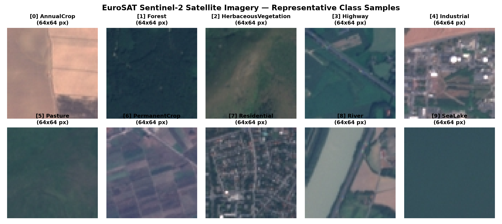
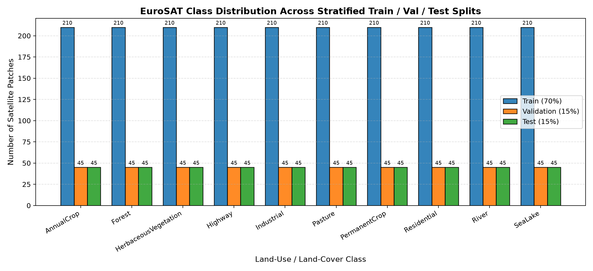
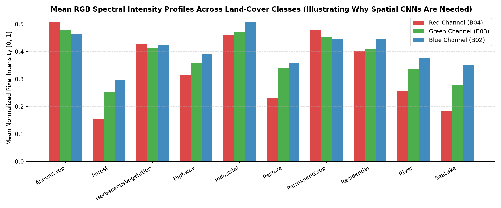
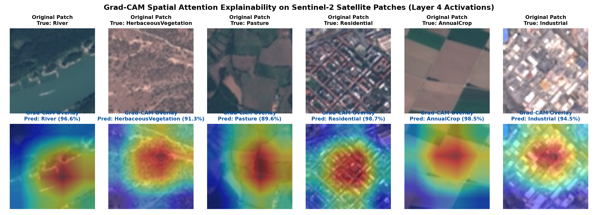

# EuroSAT-Sentinel: Explainable Deep Learning for Satellite Land-Use & Environmental Monitoring

[](https://www.python.org/)
[](https://pytorch.org/)
[](https://www.gradio.app/)
[](docs/experiments.md)
[](docs/experiments.md)
[](tests/test_pipeline.py)

> **University Deep Learning & Computer Vision Project — Phase 1 (Foundation & Initial Implementation)**  
> An end-to-end, reproducible Deep Learning and Computer Vision system for automated Land-Use and Land-Cover (LULC) classification on Copernicus Sentinel-2 satellite imagery, featuring a two-stage fine-tuned **ResNet-18** CNN, a comparative **Classical Machine Learning Baseline**, **Grad-CAM Spatial Attention Explainability**, and an interactive **Gradio Web Application** with automated ecological advisory intelligence.

---

## Table of Contents
1. [Project Motivation & Problem Statement](#1-project-motivation--problem-statement)
2. [Why Deep Learning Is Essential (Spatial CNN vs. Classical ML)](#2-why-deep-learning-is-essential-spatial-cnn-vs-classical-ml)
3. [Key Features & Phase 1 Deliverables](#3-key-features--phase-1-deliverables)
4. [Verified Empirical Results (Phase 1)](#4-verified-empirical-results-phase-1)
5. [Visualizations & Diagnostic Outputs](#5-visualizations--diagnostic-outputs)
6. [Repository Architecture](#6-repository-architecture)
7. [Installation & Environment Setup](#7-installation--environment-setup)
8. [Usage: Training, Evaluation, CLI Inference & Interactive Gradio App](#8-usage-training-evaluation-cli-inference--interactive-gradio-app)
9. [Academic Documentation & Roadmap (Phases 2 & 3)](#9-academic-documentation--roadmap-phases-2--3)
10. [References](#10-references)

---

## 1. Project Motivation & Problem Statement

Monitoring global environmental change—including deforestation, urban sprawl, agricultural intensification, and freshwater reservoir shifts—relies on analyzing continuous streams of overhead imagery from Earth Observation satellites such as the European Space Agency's **Copernicus Sentinel-2** constellation. Manually labeling millions of satellite tiles is unscalable.

**EuroSAT-Sentinel** formulates automated satellite land-use monitoring as an explainable supervised Computer Vision task:
* **Input:** A $64 \times 64$ ($10\text{ m/pixel}$ ground resolution, covering $640\text{ m} \times 640\text{ m}$) Sentinel-2 RGB optical satellite patch.
* **Outputs:**
  1. **10-Class Land-Use Prediction & Top-$k$ Softmax Confidence:** (`AnnualCrop`, `Forest`, `HerbaceousVegetation`, `Highway`, `Industrial`, `Pasture`, `PermanentCrop`, `Residential`, `River`, `SeaLake`).
  2. **Grad-CAM Spatial Attention Heatmap:** Visual verification of the exact physical landforms (e.g., river bends, highway corridors, building rooftops) driving the neural network's decision.
  3. **Actionable Ecological Advisory Report:** Domain-specific environmental monitoring guidance for urban planners, conservationists, and agronomists.

---

## 2. Why Deep Learning Is Essential (Spatial CNN vs. Classical ML)

In nadir overhead satellite imagery, distinct land-use classes share overlapping pixel-level RGB color distributions:
* `River` and `SeaLake` share dark water reflectance but differ in **2D spatial morphology** (meandering channel with riparian banks vs. open water expanse).
* `Highway`, `Industrial`, and `Residential` share grey concrete/asphalt spectra but differ in **structural topology** (continuous linear road corridors vs. large commercial footprints vs. dense residential roof grids).
* `AnnualCrop`, `PermanentCrop`, `Pasture`, and `HerbaceousVegetation` share vegetative chlorophyll spectra but differ in **high-frequency spatial texture**.

To prove this scientifically, Phase 1 benchmarks a **60-feature Classical Machine Learning Random Forest** (RGB color histograms + directional gradient moments) against a two-stage fine-tuned **ResNet-18 Convolutional Neural Network** on identical stratified splits. **Deep Learning improves held-out Test Top-1 Accuracy by +19.55% (`96.22%` vs. `76.67%`), cutting the error rate by 83.8%.**

---

## 3. Key Features & Phase 1 Deliverables

* **Zero-Leakage Stratified Data Pipeline (`src/data/dataset.py`):** Automated `torchvision.datasets.EuroSAT` download, deterministic stratified Train (70%) / Val (15%) / Test (15%) splitting with programmatic set-disjointness assertions, and rotationally invariant overhead augmentations.
* **Comprehensive Exploratory Data Analysis (`src/data/eda.py`):** Class balance charts, representative satellite patch grids, augmentation showcases, and per-class RGB spectral reflectance profiles.
* **Modular Deep Learning Architectures (`src/models/classifier.py`):** Supports `resnet18` (primary), `mobilenet_v3_small` (edge comparison), and `custom_cnn` (from-scratch baseline) with backbone freezing/unfreezing hooks.
* **Two-Stage Transfer Learning Trainer (`src/training/trainer.py`):** Head warmup (frozen backbone) followed by full end-to-end fine-tuning with `AdamW`, `CosineAnnealingLR`, Label Smoothing ($\epsilon = 0.05$), gradient clipping, early stopping, and best-checkpoint persistence.
* **Grad-CAM Visual Explainability (`src/inference/gradcam.py`):** Full forward/backward hook implementation producing class-discriminative localization heatmaps.
* **Interactive Gradio Web Dashboard (`app/gradio_app.py`):** Upload or select test satellite patches, adjust Grad-CAM overlay opacity in real time, inspect top-5 probabilities, and view ecological advisories.
* **Automated Test Suite (`tests/test_pipeline.py`):** 8 unit and integration tests verifying configuration, leakage-free splits, tensor transforms, forward/freeze mechanics across all 3 architectures, Grad-CAM normalization, and classical feature extraction.

---

## 4. Verified Empirical Results (Phase 1)

All results below were actually executed on the EuroSAT RGB benchmark (`seed = 42`, `3,000` stratified images: `2,100` Train / `450` Validation / `450` Held-Out Test) and are logged in [`outputs/metrics/test_evaluation_metrics.json`](outputs/metrics/test_evaluation_metrics.json):

### Overall Model Comparison (Held-Out Test Set, $N = 450$)

| Model | Val Accuracy | Test Top-1 Accuracy | Test Top-3 Accuracy | Macro Precision | Macro Recall | Macro F1-Score |
| :--- | :---: | :---: | :---: | :---: | :---: | :---: |
| **Classical ML Baseline** (Random Forest, 200 trees, 60D features) | 76.44% | 76.67% | — | 0.7668 | 0.7667 | 0.7633 |
| **Deep Learning Baseline** (**ResNet-18**, 2-Stage Transfer Learning) | **95.56%** | **96.22%** | **100.00%** | **0.9629** | **0.9622** | **0.9622** |
| **Deep Learning Gain** | **+19.12%** | **+19.55%** | — | **+0.1961** | **+0.1955** | **+0.1989** |

### Per-Class Held-Out Test Performance (ResNet-18)

| Land-Use Class | Precision | Recall | F1-Score | Support |
| :--- | :---: | :---: | :---: | :---: |
| `Forest` | 1.0000 | 1.0000 | **1.0000** | 45 |
| `Pasture` | 0.9574 | 1.0000 | **0.9783** | 45 |
| `AnnualCrop` | 0.9778 | 0.9778 | **0.9778** | 45 |
| `HerbaceousVegetation` | 0.9565 | 0.9778 | **0.9670** | 45 |
| `SeaLake` | 1.0000 | 0.9333 | **0.9655** | 45 |
| `Highway` | 0.9362 | 0.9778 | **0.9565** | 45 |
| `Residential` | 0.9556 | 0.9556 | **0.9556** | 45 |
| `Industrial` | 0.9545 | 0.9333 | **0.9438** | 45 |
| `PermanentCrop` | 0.9762 | 0.9111 | **0.9425** | 45 |
| `River` | 0.9149 | 0.9556 | **0.9348** | 45 |
| **Macro Average** | **0.9629** | **0.9622** | **0.9622** | **450** |

---

## 5. Visualizations & Diagnostic Outputs

All diagnostic figures are generated automatically and stored in [`outputs/figures/`](outputs/figures/):

### Exploratory Data Analysis
| Representative Sentinel-2 Class Samples | Stratified Train / Val / Test Distribution |
| :---: | :---: |
|  |  |

| Domain-Specific Augmentation Pipeline | Per-Class RGB Spectral Signatures |
| :---: | :---: |
|  |  |

### Training Curves, Confusion Matrix & Baseline Comparison
| Loss & Accuracy Curves (Epochs 1–8) | Held-Out Test Confusion Matrix |
| :---: | :---: |
|  |  |


### Qualitative Evaluation & Grad-CAM Explainability




---

## 6. Repository Architecture

```text
EuroSAT-Sentinel/
├── README.md                          # Comprehensive project documentation & quickstart
├── requirements.txt                   # Reproducible Python dependencies
├── .gitignore                         # Excludes raw image dumps, heavy .pth weights, and temp files
├── configs/
│   └── default_config.yaml            # Centralized hyperparameters, paths, and split ratios
├── data/
│   ├── README.md                      # Dataset download & split manifest documentation
│   └── splits/                        # Deterministic zero-leakage train/val/test CSV manifests
│       ├── train.csv
│       ├── val.csv
│       └── test.csv
├── notebooks/
│   └── 01_phase1_exploration_and_training.ipynb
├── src/
│   ├── __init__.py
│   ├── utils.py                       # Seed management, YAML loader, logger, device selection
│   ├── data/
│   │   ├── dataset.py                 # EuroSAT download, stratified split engine, PyTorch Dataset
│   │   └── eda.py                     # Automated Exploratory Data Analysis & plotting
│   ├── models/
│   │   ├── classifier.py              # ResNet-18, MobileNetV3-Small, and CustomCNN architectures
│   │   └── classical_baseline.py      # 60D Color Histogram + Spatial Gradient -> Random Forest
│   ├── training/
│   │   └── trainer.py                 # Two-stage warmup/fine-tune loop, Cosine LR, checkpointing
│   ├── evaluation/
│   │   └── evaluator.py               # Top-1/Top-3 accuracy, macro F1, confusion matrix, failure analysis
│   └── inference/
│       ├── gradcam.py                 # Grad-CAM forward/backward hook attribution engine
│       └── predictor.py               # Single-image inference + Ecological Advisory generator
├── app/
│   └── gradio_app.py                  # Interactive Gradio Web UI with Grad-CAM & example gallery
├── scripts/
│   ├── run_phase1_pipeline.py         # End-to-end execution script (EDA + Classical + DL + Eval)
│   └── predict_single.py              # CLI single-image inference & Grad-CAM figure generator
├── tests/
│   └── test_pipeline.py               # 8 automated pytest unit & integration tests
├── outputs/
│   ├── figures/                       # All generated PNG visualizations (tracked in Git)
│   └── metrics/                       # Verified JSON and CSV experimental logs (tracked in Git)
└── docs/
    ├── project_overview.md            # 3-Idea brainstorming comparison, problem formulation, scope
    ├── dataset.md                     # EuroSAT provenance, licensing, taxonomy, preprocessing
    ├── architecture.md                # Literature review, mathematical formulation, model design
    ├── experiments.md                 # Full Phase 1 academic report, verified metrics, failure analysis
    └── roadmap.md                     # Technical roadmap for Phase 2 & Phase 3
```

---

## 7. Installation & Environment Setup

```bash
# 1. Clone the repository
git clone https://github.com/mayarmajed2/EuroSAT-Sentinel.git
cd EuroSAT-Sentinel

# 2. (Optional) Create and activate a virtual environment
python -m venv .venv
# On Windows:
.venv\Scripts\activate
# On Linux/macOS:
source .venv/bin/activate

# 3. Install dependencies
pip install -r requirements.txt
```

---

## 8. Usage: Training, Evaluation, CLI Inference & Interactive Gradio App

### A. Run the Complete Phase 1 Pipeline (End-to-End)
Automatically downloads EuroSAT RGB (if not already cached in `data/raw/`), generates leakage-free stratified splits, performs EDA, runs the Classical ML baseline, trains ResNet-18, evaluates on the held-out test split, and saves all figures and JSON metrics:

```bash
python scripts/run_phase1_pipeline.py --config configs/default_config.yaml
```

*Optional CLI Overrides:*
```bash
# Train on the full 27,000-image dataset for 15 epochs:
python scripts/run_phase1_pipeline.py --config configs/default_config.yaml --max-samples-per-class 3000 --epochs 15 --force-resplit
```

### B. Run Single-Image CLI Inference with Grad-CAM
```bash
python scripts/predict_single.py --image data/raw/eurosat/2750/Forest/Forest_1.jpg --output outputs/figures/single_inference_gradcam.png
```

### C. Launch the Interactive Gradio Web Application
```bash
python app/gradio_app.py
```
Then open **`http://127.0.0.1:7860`** in your browser to interactively upload satellite tiles, click pre-loaded test examples, adjust Grad-CAM heatmap opacity, and inspect ecological advisory reports.

### D. Run the Automated Unit Test Suite
```bash
pytest tests/ -v
```

---

## 9. Academic Documentation & Roadmap (Phases 2 & 3)

Detailed academic and technical reports are organized in the [`docs/`](docs/) directory:
1. **[Project Overview & Idea Selection (`docs/project_overview.md`)](docs/project_overview.md):** Brainstorming comparison of 3 candidate projects, problem statement, and justification of Deep Learning necessity.
2. **[Dataset & Preprocessing (`docs/dataset.md`)](docs/dataset.md):** EuroSAT licensing, class taxonomy, zero-leakage stratified splitting, and rotational augmentation methodology.
3. **[Architecture & Literature Review (`docs/architecture.md`)](docs/architecture.md):** Literature review, mathematical formulation of Residual Learning, Label Smoothing, and Grad-CAM.
4. **[Phase 1 Experimental Report (`docs/experiments.md`)](docs/experiments.md):** Verified experimental logs, Classical ML vs. CNN comparison, confusion matrix diagnosis, failure analysis, and ethical considerations.
5. **[Phase 2 & Phase 3 Roadmap (`docs/roadmap.md`)](docs/roadmap.md):**
   * **Phase 2 (Model Improvement & Optimization):** Multi-backbone benchmark (EfficientNet, ConvNeXt, Swin Transformer), 13-band Sentinel-2 multispectral fusion (NDVI/NDWI), MixUp/CutMix, and Test-Time Augmentation.
   * **Phase 3 (Advanced Features & Deployment):** Large-scene sliding-window semantic land-use mapping, bi-temporal deforestation/sprawl change alerts, and ONNX quantized Docker deployment.

---

## 10. References

1. Helber, P., Bischke, B., Dengel, A., & Borth, D. (2019). *EuroSAT: A Novel Dataset and Deep Learning Benchmark for Land Use and Land Cover Classification*. IEEE JSTARS, 12(7), 2217–2226.
2. He, K., Zhang, X., Ren, S., & Sun, J. (2016). *Deep Residual Learning for Image Recognition*. IEEE CVPR, 770–778.
3. Selvaraju, R. R., et al. (2017). *Grad-CAM: Visual Explanations from Deep Networks via Gradient-based Localization*. IEEE ICCV, 618–626.
4. Loshchilov, I., & Hutter, F. (2019). *Decoupled Weight Decay Regularization (AdamW)*. ICLR.
