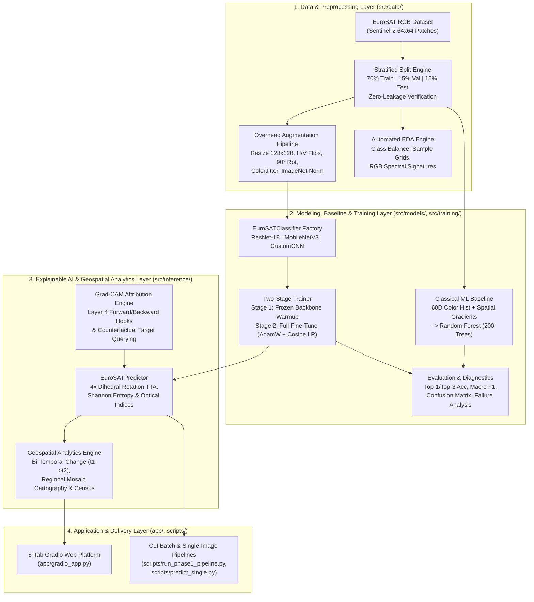
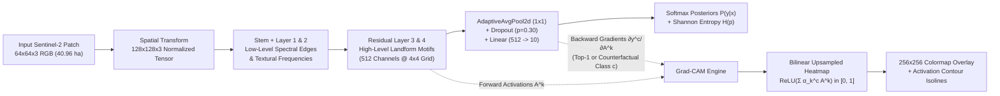
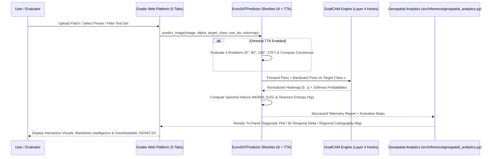

# SYSTEM ARCHITECTURE — EuroSAT-Sentinel

This document describes the end-to-end software, machine learning, explainability, and interactive web application architecture of **EuroSAT-Sentinel**.

---

## 1. High-Level Layered Architecture

The system follows a clean, decoupled 4-layer architecture separating **Data Engineering**, **Model & Training Core**, **Inference & Geospatial XAI Analytics**, and **Interactive Presentation / CLI Interfaces**.

---

## 2. Deep Learning & Grad-CAM Data-Flow Architecture

The primary neural architecture adapts **ResNet-18** (`11,181,642` parameters) to overhead $128 \times 128$ inputs so that the final convolutional stage (`layer4[-1].conv2`) preserves a $4 \times 4$ spatial activation grid prior to Global Average Pooling, enabling fine-grained Grad-CAM localization.

---

## 3. Interactive Multi-Tab Web Application Workflow

The Gradio platform (`app/gradio_app.py`) integrates five specialized workflows into a unified interface:

---

## 4. Component Responsibilities & Module Map

| Module Path | Component Name | Primary Responsibility |
| :--- | :--- | :--- |
| `configs/default_config.yaml` | Configuration Registry | Centralizes dataset paths, split ratios (`0.70/0.15/0.15`), model hyperparameters, augmentation settings, and evaluation directories. |
| `src/utils.py` | Core Utilities | Deterministic RNG seeding (`set_seed`), YAML loader (`load_config`), structured logger (`setup_logger`), and hardware auto-detection (`get_device`). |
| `src/data/dataset.py` | Data Pipeline | `EuroSAT` download/verification, stratified zero-leakage split generator (`create_stratified_splits`), overhead transforms (`get_transforms`), and PyTorch `DataLoader` builder. |
| `src/data/eda.py` | EDA Engine | Automated dataset auditing and publication-ready figure generation (`eda_class_distribution.png`, `eda_sample_grid.png`, `eda_augmentation_showcase.png`, `eda_spectral_signatures.png`). |
| `src/models/classical_baseline.py` | Classical ML Baseline | Extracts 60D handcrafted feature vectors (48D RGB color histograms + 12D spatial gradient/statistical moments) and trains a 200-tree `RandomForestClassifier`. |
| `src/models/classifier.py` | Deep Learning Models | Implements `EuroSATClassifier` supporting `resnet18`, `mobilenet_v3_small`, and `custom_cnn` (`CustomEuroSATCNN`), backbone freeze/unfreeze controls, and Grad-CAM target layer lookup. |
| `src/training/trainer.py` | Two-Stage Trainer | Executes head-warmup + full fine-tuning epochs, gradient clipping (`max_norm=2.0`), `CosineAnnealingLR`, non-regressing best-checkpoint persistence, and history logging. |
| `src/evaluation/evaluator.py` | Evaluation Suite | Computes Top-1/Top-3 accuracy, macro/per-class Precision/Recall/F1, confusion matrix, top confused class pairs, and qualitative prediction/Grad-CAM galleries. |
| `src/inference/gradcam.py` | Grad-CAM Engine | Registers PyTorch forward and full-backward hooks on the final convolutional layer, computes channel importance weights $\alpha_k^c$, and blends multi-colormap overlays. |
| `src/inference/predictor.py` | Inference & Uncertainty | Wraps checkpoint loading, $4\times$ dihedral Test-Time Augmentation (`_predict_tta`), counterfactual Grad-CAM targeting, optical spectral indices (`compute_spectral_indices`), and Shannon entropy (`compute_uncertainty_metrics`). |
| `src/inference/geospatial_analytics.py` | Geospatial Analytics | Powers tri-panel patch diagnostics, bi-temporal change detection ($t_1 \rightarrow t_2$), sliding-window regional mosaic cartography & hectare/carbon census, and interactive test-set filtering. |
| `app/gradio_app.py` | Interactive Web UI | 5-tab commercial-grade Gradio dashboard with custom CSS KPI cards, scenario presets, interactive test-table row diagnosis, and JSON/CSV export. |

---

## 5. Key Architectural Design Decisions

1. **Upsampling $64 \times 64 \rightarrow 128 \times 128$ for Spatial Attribution Fidelity:**
   Standard ImageNet ResNet-18 applies a total spatial downsampling stride of $32\times$. On a $64 \times 64$ input, `layer4` collapses to a $2 \times 2$ feature map ($4$ coarse quadrants), producing blurry Grad-CAM blobs. Upsampling inputs to $128 \times 128$ yields a $4 \times 4$ ($16$-cell) activation grid in `layer4[-1].conv2`, allowing Grad-CAM to trace curved river channels and highway corridors accurately.
2. **Non-Regressing Checkpoint Guard (`src/training/trainer.py`):**
   Before saving `best_eurosat_model.pth`, `Trainer.fit()` inspects any existing checkpoint of the same architecture on disk and only overwrites it when the new validation accuracy matches or exceeds `existing_best_val_acc`. This prevents quick 1-epoch test runs from accidentally degrading a fully trained production checkpoint.
3. **Dynamic Port Resolution (`app/gradio_app.py`):**
   Passing `server_port=None` allows Gradio to bind to port `7860` by default and automatically roll over to `7861+` if port `7860` is occupied or reserved by Windows Hyper-V/WSL, eliminating startup crashes.
