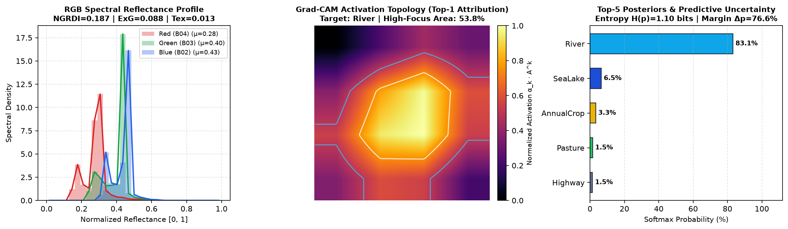
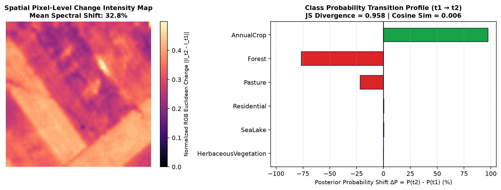
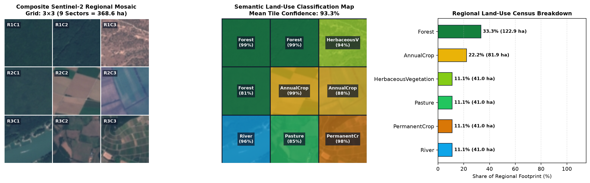
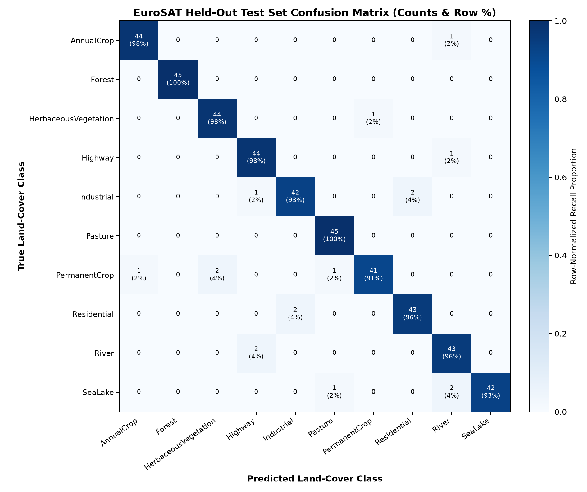

# USER GUIDE — EuroSAT-Sentinel

This user guide walks through every feature of the **EuroSAT-Sentinel** interactive web application (`app/gradio_app.py`) and command-line utilities.

---

## 1. Launching the Interactive Web Platform

Start the application from the terminal or via **`F5`** in VS Code:
```bash
python app/gradio_app.py
```
Your browser will open automatically to the **EuroSAT-Sentinel Geospatial Deep Learning Platform** (`http://127.0.0.1:7860` or `7861`).

At the top of the interface, the **Executive KPI Header** displays verified benchmark metrics:
* **ResNet-18 Test Top-1 Accuracy:** `96.22%` (`433 / 450` held-out patches)
* **Test Top-3 Accuracy:** `100.00%` (`450 / 450` held-out patches)
* **Classical ML Baseline:** `76.67%` (`+19.55%` Deep Learning gain, `83.8%` error reduction)
* **Split Integrity:** `0 Leakage` (`2,100` Train / `450` Val / `450` Test)
* **Sensor Ground Resolution:** `10 m/pixel` (`64×64` patch = `40.96 Hectares`)

---

## 2. Tab 1: 🛰️ Single-Patch XAI & Counterfactual Inspector

This tab provides deep explainability, rotational invariance testing, and spectral analysis for individual Sentinel-2 satellite tiles.



### Step-by-Step Usage:
1. **Select or Upload a Satellite Patch:**
   * Click any of the **8 pre-loaded real Sentinel-2 test examples** at the bottom of Tab 1 (`Forest`, `River`, `Highway`, `Residential`, `Industrial`, `SeaLake`, `AnnualCrop`, `PermanentCrop`), or drag-and-drop any RGB image into the upload box.
2. **Configure XAI & Inference Controls:**
   * **Grad-CAM Overlay Opacity ($\alpha$):** Drag between `0.15` and `0.85` (default `0.45`) to control heatmap blending intensity.
   * **Heatmap Colormap:** Choose from `jet`, `inferno`, `viridis`, `plasma`, or `magma`.
   * **Grad-CAM Attribution Target (Counterfactual XAI):**
     * Leave on **`Auto (Top-1 Predicted Class)`** to visualize the physical landforms driving the model's primary prediction.
     * Select any specific class (e.g., **`Highway`** or **`River`**) to perform **Counterfactual Visual Attribution**—revealing which pixels in the image activate the network for an alternative hypothesis.
   * **Enable $4\times$ Dihedral Rotation TTA:** When checked, the model evaluates the patch across all 4 cardinal orientations ($0^\circ, 90^\circ, 180^\circ, 270^\circ$), averages the softmax posteriors, and reports the rotational consensus agreement percentage.
3. **Click `🔬 Analyze Satellite Patch`**:
   * **Grad-CAM Spatial Attention Overlay:** Displays the $256 \times 256$ localized activation map from `layer4[-1].conv2`.
   * **Top-5 Land-Cover Softmax Posteriors:** Interactive horizontal probability bars.
   * **Scientific Diagnostic Tri-Panel Figure:**
     * *Left Panel:* Per-channel RGB Spectral Reflectance Histogram + Optical Indices (`NGRDI`, `ExG`, `Spatial Texture Energy`).
     * *Center Panel:* Raw Grad-CAM activation topology in $[0, 1]$ with contour isolines at `0.50` and `0.75`.
     * *Right Panel:* Top-5 posterior probabilities, **Shannon Predictive Entropy** ($H(\mathbf{p})$ in bits), and Top-2 probability margin ($\Delta p$).
   * **Ecological, Carbon & Uncertainty Intelligence Report:** Displays functional category, prediction reliability tier, estimated above-ground carbon pool ($\text{t C}$ across $40.96\text{ ha}$), impervious surface cover ($\text{ha}$), and actionable environmental advisory.
   * **Downloadable JSON Report:** Expand the bottom accordion to inspect or download the full JSON telemetry file.

---

## 3. Tab 2: 🌍 Bi-Temporal Change & Deforestation Simulator ($t_1 \rightarrow t_2$)

This tab compares two temporal satellite passes ($t_1$ vs. $t_2$) over a $40.96\text{ ha}$ sector to detect land-cover transitions and quantify environmental impact.



### Step-by-Step Usage:
1. **Choose a Curated Bi-Temporal Scenario Preset** from the dropdown:
   * `1. Deforestation Alert: Dense Forest (t1) → Annual Cropland (t2)`
   * `2. Urban Sprawl Warning: Managed Pasture (t1) → Residential Settlement (t2)`
   * `3. Industrial Corridor Encroachment: Natural Meadow (t1) → Industrial Zone (t2)`
   * `4. Hydrological Infrastructure Shift: River Corridor (t1) → Highway Corridor (t2)`
   * `5. Ecological Restoration: Annual Cropland (t1) → Mature Forest Canopy (t2)`
   * `6. Stable Forest Control: Forest Survey Pass 1 (t1) → Forest Survey Pass 2 (t2)`
2. Click **`📂 Load Scenario Preset Patches`** (or upload custom $t_1$ and $t_2$ images and click **`⚡ Run Bi-Temporal Change Detection`**).
3. **Inspect the Outputs:**
   * **Side-by-Side $t_1$ and $t_2$ Grad-CAM Overlays:** Visualizes how spatial feature attribution shifts between acquisitions.
   * **Bi-Temporal Spectral Difference & Class Posterior Shift ($\Delta P$) Figure:**
     * *Left:* Pixel-level Euclidean RGB spectral change intensity map $\|\mathbf{I}_{t_2} - \mathbf{I}_{t_1}\|_2$.
     * *Right:* Bar chart of class probability shifts $\Delta P = P(y \mid \mathbf{x}_{t_2}) - P(y \mid \mathbf{x}_{t_1})$ with **Jensen-Shannon Divergence** ($D_{\text{JS}}$) and Cosine Similarity.
   * **Executive Bi-Temporal Impact Report:** Automatically triggers an alert badge (`🔴 CRITICAL ALERT`, `🟠 URBAN SPRAWL WARNING`, `🔵 HYDROLOGICAL SHIFT`, `🟢 RESTORATION DETECTED`, or `🟢 STABLE`), reports net Carbon Stock Delta ($\Delta \text{t C}$) and Impervious Sealed Surface Delta ($\Delta \text{ha}$), and recommends policy action.

---

## 4. Tab 3: 🗺️ Regional Mosaic Scanner & Land-Use Cartography

This tab performs multi-tile sliding-window classification across a composite regional satellite scene (e.g., $3 \times 3$ sectors $= 368.64\text{ ha}$ or $4 \times 4$ sectors $= 655.36\text{ ha}$).



### Step-by-Step Usage:
1. Select one of the **4 Curated Multi-Tile Regional Mosaic Presets** (or upload any custom wide-area satellite image).
2. Adjust **Grid Rows** and **Grid Columns** ($2 \times 2$, $3 \times 3$, or $4 \times 4$).
3. Click **`🛰️ Assemble & Scan Regional Preset Mosaic`** (or **`🔍 Scan Custom Uploaded Mosaic Image`**).
4. **Inspect the Outputs:**
   * **3-Panel Semantic Cartography Figure:**
     * *Left:* Composite Sentinel-2 regional mosaic annotated with sector coordinates (`R1C1`..`R3C3`).
     * *Center:* Color-coded **Semantic Land-Use Thematic Map** labeled with predicted class and per-sector confidence.
     * *Right:* Regional land-use share ($\%$) and area ($\text{ha}$) bar chart.
   * **Automated Regional Land-Use & Carbon Census Table:** Lists every detected land-use class, tile count, total area in hectares ($\text{ha}$), regional share ($\%$), mean confidence, carbon stock ($\text{t C}$), and impervious footprint ($\text{ha}$).
   * **Downloadable CSV Census:** Click the file widget to download `regional_landuse_census.csv`.

---

## 5. Tab 4: 📊 Benchmark Explorer & Failure Case Diagnosis

This tab provides full transparency into all **450 held-out test set predictions** (`433` correct, `17` misclassified).



### Step-by-Step Usage:
1. **Filter the Held-Out Test Set:**
   * Filter by **Ground-Truth Class** (`All Classes` or any of the 10 classes).
   * Filter by **Prediction Outcome** (`All Predictions`, `Correct Only (433)`, or `Misclassified / Hard Cases Only (17)`).
   * Set a **Minimum Confidence Filter (%)** and click **`🔎 Apply Filter`**.
2. **Interactive Row-Click Grad-CAM Diagnosis:**
   * **Click any row** in the filtered predictions table (or type a filename such as `River_1469.jpg` and click **`🔬 Diagnose Patch`**).
   * The right panel immediately loads that exact satellite patch from disk, runs ResNet-18 + Grad-CAM + Dihedral TTA, and renders its Grad-CAM overlay and Tri-Panel Spectral & Uncertainty breakdown.
3. **Verified Experimental Figures Gallery:**
   * Scroll down to inspect high-resolution diagnostic plots from the Phase 1 pipeline (`Confusion Matrix`, `Per-Class F1 & Classical vs. DL Baseline`, `Training Curves`, `Correct vs. Failure Gallery`, `Grad-CAM Gallery`, and `EDA Spectral Signatures`).

---

## 6. Tab 5: 🎓 Professor Live Demo Mode & Academic Methodology

Provides a structured **5-Minute Live Demonstration Script** and a quick-reference table mapping every mathematical equation in the project directly to its Python source file and function.
