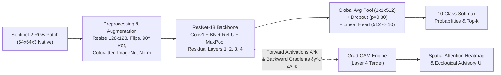

# Model Architecture, Theoretical Justification & Literature Review

## 1. Academic Literature Review

Deep Learning has fundamentally transformed Earth Observation (EO) and Land-Use / Land-Cover (LULC) classification over the past decade:

1. **Deep Residual Learning for Image Recognition (He et al., CVPR 2016):** Introduced identity shortcut connections ($\mathbf{y} = \mathcal{F}(\mathbf{x}, \{W_i\}) + \mathbf{x}$) that eliminate vanishing gradients in deep convolutional networks, enabling rich hierarchical spatial feature extraction.
2. **EuroSAT Benchmark & Transfer Learning in Remote Sensing (Helber et al., IEEE JSTARS 2019):** Demonstrated that fine-tuning ImageNet-pretrained CNNs (ResNet-50, GoogLeNet) on Sentinel-2 RGB satellite patches substantially outperforms classical bag-of-visual-words, SIFT, and color-histogram classifiers, achieving $>95\%$ accuracy on the full 27,000-image benchmark.
3. **Neumann et al. (arXiv:1911.06721, 2019) — *In-Domain Representation Learning for Remote Sensing*:** Showed that low- and mid-level Gabor-like edge, corner, and texture filters learned on natural imagery transfer effectively to nadir overhead satellite imagery when fine-tuned with moderate learning rates and rotational data augmentation.
4. **Grad-CAM Explainable AI (Selvaraju et al., ICCV 2017):** Formulated gradient-weighted class activation mapping, computing neuron importance weights $\alpha_k^c = \frac{1}{Z} \sum_i \sum_j \frac{\partial y^c}{\partial A_{i,j}^k}$ over the final convolutional feature map $A^k$ to produce class-discriminative localization maps $L_{\text{Grad-CAM}}^c = \text{ReLU}\left(\sum_k \alpha_k^c A^k\right)$.

### Distinction Between Existing Techniques and Our Project's Contribution
* **Existing Techniques Used:** Pretrained ResNet-18 / MobileNetV3 backbones (He et al., 2016; Howard et al., 2019), AdamW optimization with Cosine Annealing (Loshchilov & Hutter, 2017/2019), and Grad-CAM attribution (Selvaraju et al., 2017).
* **Project Value & Synthesis (`EuroSAT-Sentinel`):**
  1. **Controlled Spatial-vs-Spectral Ablation:** Directly pairs the Deep Learning pipeline against a custom 60-feature Classical ML baseline (RGB color histograms + directional spatial gradient moments + Random Forest) on identical stratified splits to quantify the exact contribution of learned hierarchical spatial filters.
  2. **Spatial Resolution Adaptation for XAI:** Adapts native $64 \times 64$ Sentinel-2 tiles to $128 \times 128$ inputs so that `layer4` retains a $4 \times 4$ spatial grid rather than collapsing to $2 \times 2$, yielding sharp Grad-CAM localization of rivers, highways, and residential blocks.
  3. **End-to-End Decision Support Integration:** Bridges raw softmax probabilities and Grad-CAM visualizations with domain-specific ecological indicators and actionable environmental advisories inside a self-contained Gradio application.

---

## 2. System & Model Architecture

### 2.1 Primary Deep Learning Architecture: `ResNet-18` (`src/models/classifier.py`)
We select **ResNet-18** (`11,181,642` total parameters) as the primary Phase 1 architecture for three scientifically defensible reasons:
1. **Capacity-to-Dataset Balance:** With 3,000–27,000 small satellite patches, massive backbones (e.g., ResNet-152 or ViT-Large with $>80\text{M}$ parameters) overfit rapidly and waste compute, whereas ResNet-18 provides strong inductive bias with fast convergence (~2–3 seconds per epoch on an NVIDIA RTX 3050 Laptop GPU).
2. **Residual Gradient Flow & Feature Hierarchy:** Its 4 residual stages progressively expand receptive fields from local $3 \times 3$ spectral edges to full-patch landform layouts.
3. **Regularized Classification Head:** We replace the original 1,000-class linear layer with a regularized head:
   $$\mathbf{z} = \mathbf{W}_{\text{cls}} \cdot \text{Dropout}_{p=0.30}\left(\text{GAP}(\mathbf{A}^{(4)})\right) + \mathbf{b}_{\text{cls}}, \quad \mathbf{W}_{\text{cls}} \in \mathbb{R}^{10 \times 512}$$

### 2.2 Modular Alternative Backbones Included
To support immediate Phase 2 ablation studies via a single config change (`model.architecture`), `EuroSATClassifier` also implements:
* **`mobilenet_v3_small`:** Ultra-lightweight depthwise-separable CNN (~1.5M parameters) for edge/drone deployment comparisons.
* **`custom_cnn` (`CustomEuroSATCNN`):** A 4-stage BatchNorm convolutional network (~420K parameters) trained from scratch without ImageNet pretraining.

---

## 3. Two-Stage Transfer Learning & Optimization Strategy

Directly fine-tuning all layers of a pretrained network with a randomly initialized classification head can corrupt early convolutional filters via large initial backpropagated gradients. Our `Trainer` (`src/training/trainer.py`) mitigates this via a **Two-Stage Training Protocol**:

1. **Stage 1 — Classification Head Warmup (Epochs 1–2):**
   * All convolutional backbone layers (`conv1` through `layer4`) are frozen (`requires_grad = False`).
   * Only the new `Dropout + Linear(512 -> 10)` classification head is updated, aligning output hyperplane weights with pretrained feature representations.
2. **Stage 2 — Full End-to-End Fine-Tuning (Epochs 3–12):**
   * The entire ResNet-18 backbone is unfrozen (`requires_grad = True`) and adapted jointly to the overhead satellite domain.
3. **Loss Function — Label-Smoothed Cross-Entropy ($\epsilon = 0.05$):**
   $$\mathcal{L}_{\text{LS}}(\mathbf{p}, y) = -\sum_{c=1}^{C} \tilde{y}_c \log(p_c), \quad \text{where } \tilde{y}_c = (1 - \epsilon)\mathbb{I}[c = y] + \frac{\epsilon}{C}$$
   Label smoothing prevents overconfident logit saturation on ambiguous boundary tiles (e.g., a highway passing alongside a forest).
4. **Optimizer & Schedule:**
   * **AdamW** ($\text{ lr } = 5 \times 10^{-4}$, decoupled weight decay $\lambda = 10^{-4}$) with global gradient L2-norm clipping (`max_norm = 2.0`).
   * **Cosine Annealing Learning Rate Scheduler** smoothly decays the learning rate to $\eta_{\min} = 5 \times 10^{-6}$, ensuring stable convergence into a flat minimum.
